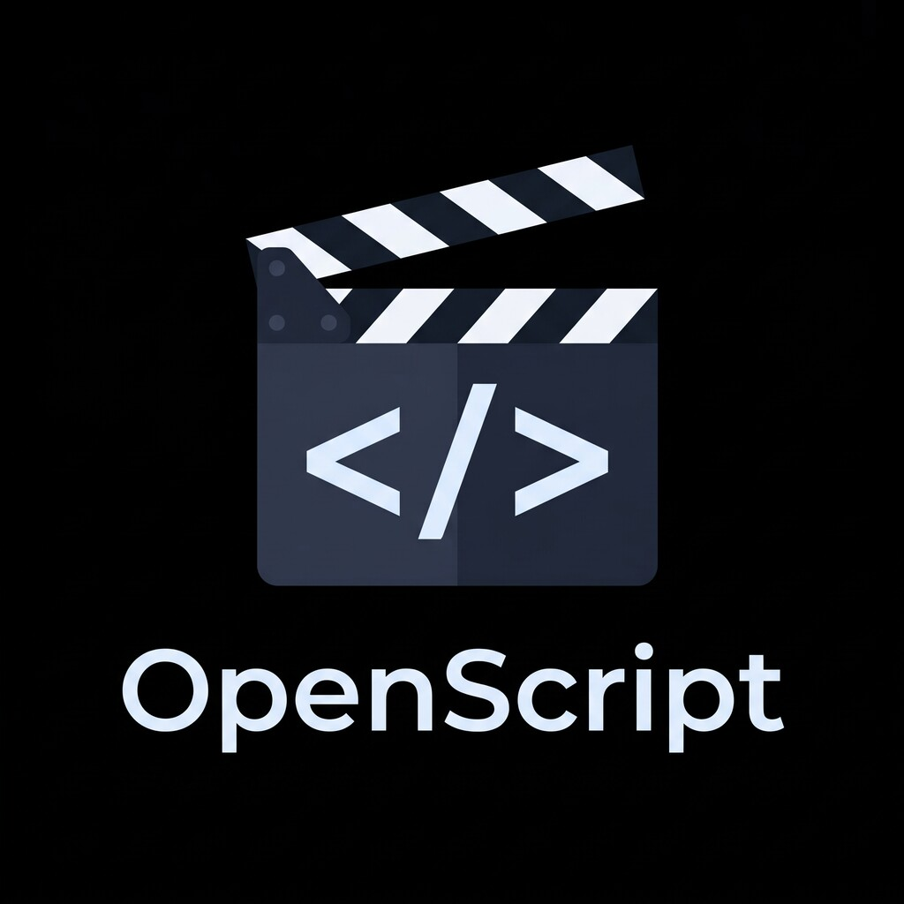
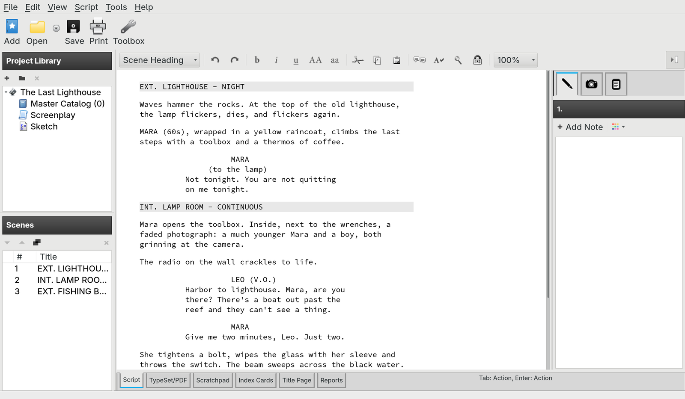
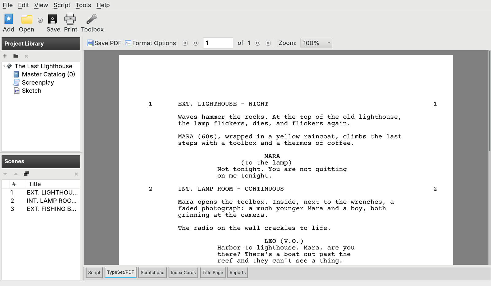
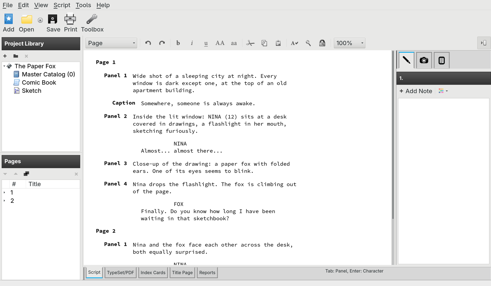
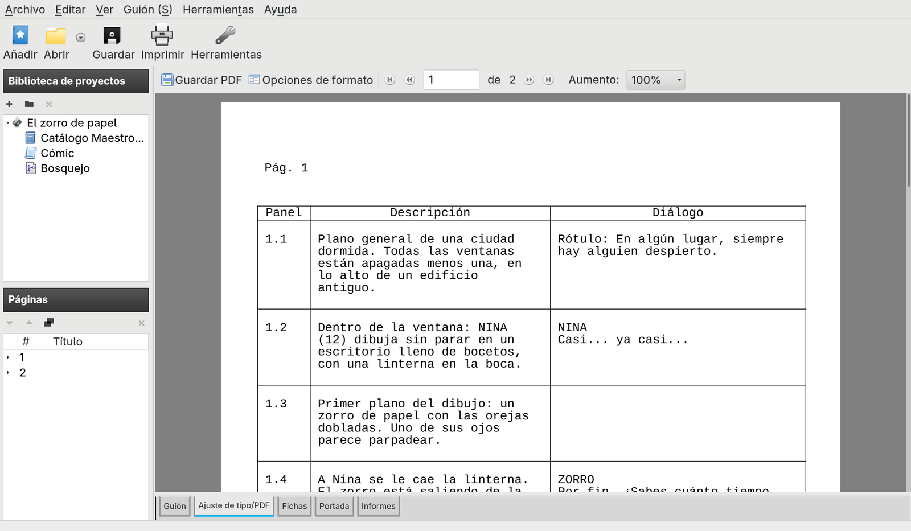
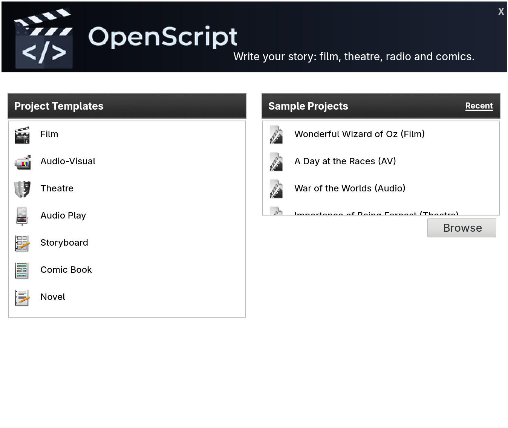
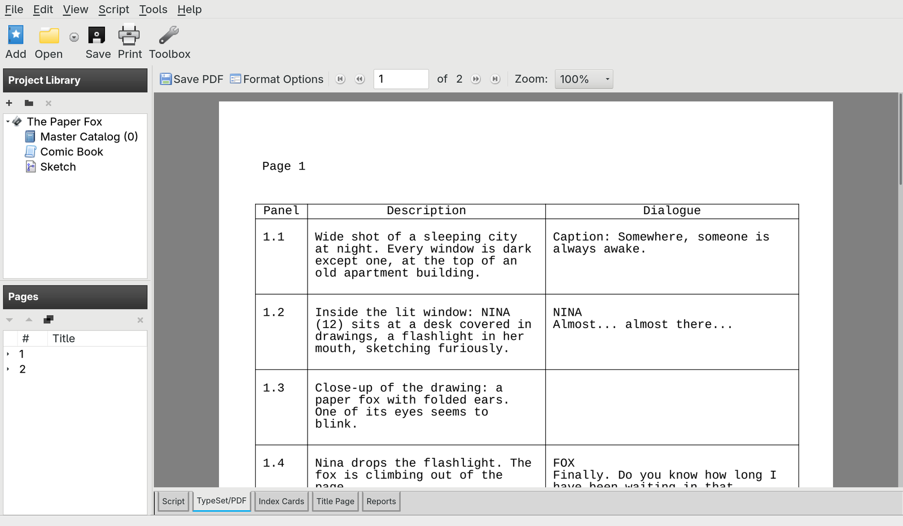

<p align="center">
  
</p>

# OpenScript

🌐 [English](README.md) · **Español** · ❤️ [Apoya el proyecto](#apoya-a-openscript)

**Un programa simple y profesional, de código abierto, para escribir guiones de cine, cómics,
teatro, radio y más.** Una nueva vida para el legendario Celtx 2.9.7, revivido para los equipos
actuales.

> OpenScript es un proyecto independiente basado en el código abierto de Celtx 2.9.7
> (Mozilla Public License 2.0). **No está afiliado, patrocinado ni respaldado por Celtx Inc.**
> «Celtx» es una marca registrada de su respectivo propietario. Consulta [NOTICE.md](NOTICE.md).

## Capturas

| Guion de cine | Vista previa (PDF) |
|---|---|
|  |  |
| **Guion de cómic** | **PDF de cómic: Panel / Descripción / Diálogo** |
|  |  |
| **Pantalla de bienvenida** | **Interfaz en inglés** (según el idioma del sistema) |
|  |  |

## Por qué existe OpenScript

Celtx 2.9.7 era sencillo y útil: abrías el programa y escribías tu guion de cine, tu obra de teatro
o tu cómic con el formato correcto, sin cuentas, sin suscripciones y sin depender de internet.
Muchos aprendimos a escribir guiones con él.

Cuando Celtx abandonó la versión de escritorio, ese programa quedó atrapado en la obsolescencia:
dejó de instalarse en sistemas actuales y sus funciones clave, como exportar a PDF, dejaron de
funcionar porque dependían de servidores que se apagaron. Pero el programa en sí seguía siendo
bueno, y su código es abierto.

**OpenScript nace de la convicción de que una herramienta así no merece quedar encerrada en la
obsolescencia.** El objetivo es mantenerla viva, libre y funcionando en equipos actuales, y
asegurarse de que lo que escribas en ella se pueda abrir siempre, gracias a formatos abiertos como
Fountain.

## Simple a propósito

Hoy muchas herramientas de escritura acumulan cientos de funciones: espacios en la nube, paneles de
colaboración, flujos de producción, asistentes de IA. Todo eso se interpone entre tú y la página.
OpenScript va en sentido contrario: **está hecho para escribir.** Lo abres, eliges el tipo de guion y
empiezas a teclear; el formato se aplica solo. Todo lo que tiene está para ayudarte a escribir, y
nada más compite por tu atención.

## Funciones

Todo lo que ofrecía Celtx 2.9.7 de escritorio, funcionando sin internet:

- **Formatos de guion:** cine, teatro, radio/pódcast, audiovisual a dos columnas (AV), cómic y
  novela.
- **Formato automático:** encabezados de escena, acción, personajes, diálogos, acotaciones,
  transiciones, planos, paneles y rótulos. *Tab* y *Enter* saltan al elemento correcto, y los
  nombres de personajes y encabezados se autocompletan.
- **Adaptar un guion a otro formato,** por ejemplo de cine a teatro.
- **Portada,** numeración de escenas, saltos de página y maquetación de impresión estándar.
- **Fichas** para estructurar y reordenar escenas, y un **block de notas** para ideas sueltas.
- **Notas y archivos** (imágenes, audio, enlaces) en cualquier punto del guion.
- **Catálogo maestro y desglose del guion:** personajes, locaciones, utilería, vestuario, efectos y
  más, con informes de desglose.
- **Informes** de escenas, personajes y diálogos.
- Editor de **storyboard** y una herramienta de **bocetos** para diagramas y plantas.
- **Calendario y plan de producción.**
- **Proyectos en un solo archivo `.celtx`** que guarda todos tus documentos juntos.
- **Corrector ortográfico** en español e inglés.

## Qué aporta respecto a Celtx 2.9.7

Celtx de escritorio dejó de mantenerse en 2017 y varias de sus funciones dependían de
servidores que ya no existen. OpenScript lo devuelve a la vida:

- **PDF y vista previa sin internet.** El PDF lo generaba un servidor de Celtx que ya no existe;
  ahora lo hace un servidor local con la misma maquetación:
  - **Cine:** guion en formato estándar de industria.
  - **Cómic:** una hoja por página del cómic, con la tabla Panel | Descripción | Diálogo.
- **Exportación a formatos libres y estándar** desde *Guion → Exportar*:
  - **Fountain** (`.fountain`): texto plano, el estándar abierto de guiones.
  - **Final Draft** (`.fdx`).
  - **PDF**.
  - **OpenDocument** (`.odt`) y **Word** (`.docx`); estos dos necesitan LibreOffice.
- **Sin errores al iniciar.** Se eliminaron las conexiones a los servicios antiguos de Celtx, que
  provocaban alertas de cifrado (`ssl_error_no_cypher_overlap`).
- **Interfaz en inglés y en español**, según el idioma de tu sistema, con corrector ortográfico en ambos idiomas. Los PDF y las exportaciones usan el mismo idioma.
- **Linux moderno:**
  - Tema claro legible aunque el escritorio use un tema oscuro.
  - Vista previa nítida en pantallas HiDPI/4K.
- **Tus proyectos `.celtx` siguen siendo compatibles:** se abren y guardan igual que antes.

## Descargar e instalar

[](https://github.com/alexroses47/OpenScript/releases/latest)

Descarga la última versión desde la página de **[Releases](https://github.com/alexroses47/OpenScript/releases/latest)**.

### Linux (x86_64): AppImage (recomendado)

Un solo archivo que funciona en casi cualquier distribución actual (Ubuntu 22.04 o posterior,
Fedora, Debian 12, openSUSE, Arch, Mint…) **sin instalar nada más**: trae dentro todo lo que
necesita.

```sh
chmod +x OpenScript-*-x86_64.AppImage
./OpenScript-*-x86_64.AppImage
```

- **Menú de aplicaciones:** para añadirlo y abrir los `.celtx` con doble clic, ejecuta
  `./OpenScript-*-x86_64.AppImage --instalar`. Para quitarlo del menú, usa `--desinstalar`.
- **Alternativa:** gestores como [Gear Lever](https://flathub.org/apps/it.mijorus.gearlever) o
  AppImageLauncher hacen lo mismo de forma gráfica.

### Linux (x86_64): paquete con instalador

```sh
tar xzf OpenScript-*-linux-x86_64.tar.gz
cd OpenScript
./install.sh
```

El instalador comprueba las dependencias; si falta algo, te da el comando exacto para
instalarlo (por ejemplo, en openSUSE: `sudo zypper in libpng12-0`). Para desinstalar,
ejecuta `./uninstall.sh`. Tu perfil y tus proyectos se conservan.

### Windows (10 y 11)

**Instalador (recomendado):** ejecuta `OpenScript-*-windows-setup.exe` y sigue el asistente de
siempre, *Siguiente → Siguiente*. Puedes elegir la carpeta de instalación, crear un acceso directo
en el escritorio y abrir los `.celtx` con OpenScript. Se instala solo para ti, sin permisos de
administrador (o para todos los usuarios, si lo eliges), y se desinstala desde *Configuración →
Aplicaciones*.

**Portable:** descomprime `OpenScript-*-windows.zip` donde quieras y abre **`OpenScript.exe`**. No
se instala nada.

> **Windows SmartScreen:** la primera vez que abras el instalador o la app, Windows puede mostrar *«Windows protegió tu PC»*. Ocurre porque la app es nueva y no lleva una firma digital de pago, no porque sea peligrosa.
> Pulsa **Más información → Ejecutar de todas formas**. Solo tendrás que hacerlo una vez.

No necesita instalación. Para exportar a ODT/DOCX, instala [LibreOffice](https://www.libreoffice.org/).

### macOS (Apple Silicon e Intel)

1. Abre `OpenScript-*-macos.dmg` y arrastra **OpenScript** a **Aplicaciones**.
2. Abre OpenScript desde Aplicaciones. El primer arranque tarda un poco más mientras se prepara.

- **En Apple Silicon (M1 y posteriores) hace falta Rosetta 2.** Si no está instalado, OpenScript te
  avisa; se instala desde Terminal con `softwareupdate --install-rosetta`.
- **La primera vez:** la app no está notarizada por Apple, así que macOS la bloquea la primera vez:
  - **macOS 15 o posterior:** después del aviso, ve a *Ajustes del Sistema → Privacidad y
    seguridad* y pulsa **Abrir igualmente**.
  - **macOS 14 o anterior:** clic derecho sobre la app → **Abrir**.
  - **Desde Terminal (cualquier versión):** ejecuta `xattr -dr com.apple.quarantine /Applications/OpenScript.app`.
- **Cómo funciona:** la versión original de Celtx para Mac es de 32 bits y ya no funciona en macOS
  actual, así que OpenScript para Mac ejecuta la versión de Windows del motor con un
  [Wine](https://www.winehq.org) incluido, y el servidor de PDF y exportación funciona de forma nativa.
- **Versiones futuras de macOS:** Apple anunció que después de macOS 27 Rosetta 2 dejará de ser una
  herramienta de uso general (solo se mantendrá para algunos juegos antiguos). OpenScript para Mac
  depende de ella, así que podría dejar de funcionar en versiones posteriores.

## Cómo está hecho

OpenScript no redistribuye un Celtx modificado a mano. Toma las versiones **originales**
de Celtx 2.9.7 (Linux y Windows) y les aplica los cambios de este repositorio:

| Carpeta | Contenido |
|---|---|
| `overlay/common/` | Cambios para todas las plataformas:<br>• servicios sin conexiones caducadas<br>• menú Exportar ampliado<br>• marca OpenScript (textos, bienvenida, «Acerca de»)<br>• enlaces de ayuda a este proyecto<br>• servicios en línea de Celtx retirados ocultos<br>• idioma de la interfaz según el sistema |
| `patches/` | Cambios al código original de Celtx (`nsCeltxService.js`, `scripteditor.js`), guardados como parches sobre los archivos originales y aplicados al compilar. |
| `overlay/linux/` | Lanzador, ajuste de tema GTK y estilos de legibilidad. |
| `server/` | Servidor local (Python) de PDF, vista previa y exportación (Fountain, FDX, ODT, DOCX), más el lanzador de Windows. |
| `tests/` | Pruebas de regresión de maquetación: PDF de referencia (cine, cómic, teatro) comparados línea por línea en cada compilación. |
| `scripts/assemble.py` | Arma los paquetes a partir de los binarios originales. |
| `packaging/linux/` | Instalador y desinstalador del paquete `.tar.gz`. |
| `packaging/appimage/` | Construcción del AppImage (libpng 1.2, GTK2, servidor congelado). |
| `packaging/macos/` | App de macOS: Wine con el motor de Windows, servidor nativo, lanzador en Swift para abrir archivos desde el Finder, `.dmg`. |
| `build.sh` | Compilación local en un solo comando. |
| `.github/workflows/` | Compilación automática del AppImage, el paquete de Linux, el instalador y el zip de Windows, y la app de macOS, con pruebas en varias distribuciones Linux y en Apple Silicon. |

Los binarios originales de Celtx 2.9.7 se publican como archivos de la release
`upstream-2.9.7`, para no depender de enlaces que ya no existen. El código fuente original
de Celtx 2.9.7 (MPL 2.0) está publicado por Celtx como `celtx-2-9-7-src.tar.bz2`.

### Compilar tú mismo

Un solo comando descarga los binarios originales (verificando sus sumas SHA-256) y genera el
paquete en `dist/`:

```sh
git clone https://github.com/alexroses47/OpenScript.git
cd OpenScript
./build.sh            # AppImage
./build.sh tarball    # paquete .tar.gz con instalador
```

- **AppImage:** se compila dentro de un contenedor de Ubuntu 22.04, así que solo necesitas
  `podman` o `docker`. Si ya estás en Ubuntu 22.04 con las dependencias, se compila directamente.
- **Paquete `.tar.gz`:** necesita `python3`, `gcc` y `7z`.
- **Windows y macOS:** los paquetes los compila GitHub Actions
  ([`.github/workflows/build.yml`](.github/workflows/build.yml)). Si haces un *fork*, obtendrás
  tus propios paquetes de Linux, Windows y macOS automáticamente.

## Apoya a OpenScript

OpenScript es gratis y lo seguirá siendo siempre. Si te resulta útil y quieres aportar algo, puedes
hacer una donación en criptomonedas.

**USDC en la red Solana**


```
DE3ZBDqJ1iUunRTz7KkQQj8QrNFdHkyjv38FNQHLchJT
```

> [!WARNING]
> Envía únicamente **USDC** por la red **Solana** a esta dirección. Cualquier otra moneda, o la
> misma moneda enviada por otra red, se perderá y no se podrá recuperar.

**Ten en cuenta:** las donaciones son voluntarias y no se reembolsan. No pagan nada a cambio: ni
productos, ni servicios, ni ventajas, ni versiones anticipadas o exclusivas, ni soporte
prioritario, ni voz en las decisiones del proyecto. Todas las versiones siguen siendo gratuitas y
públicas para todo el mundo.

## Créditos

- **Programa original:** Celtx 2.9.7, del equipo de Celtx (Greyfirst Corp.), publicado como código
  abierto bajo la MPL 2.0. Los créditos originales se conservan en la ventana *Acerca de* de la app.

## Licencia

[Mozilla Public License 2.0](LICENSE), igual que Celtx 2.9.7. Los componentes de terceros
se detallan en [NOTICE.md](NOTICE.md).
