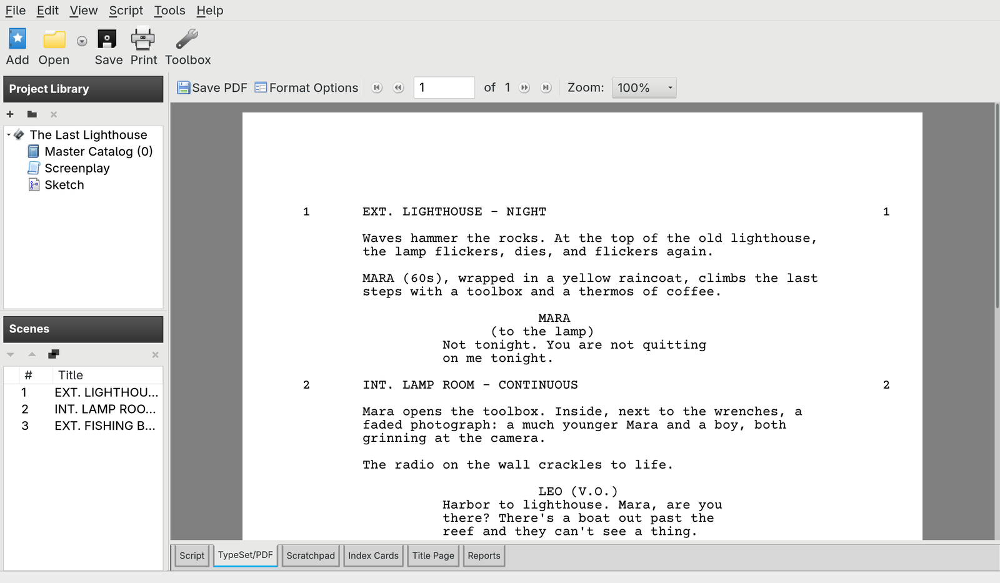
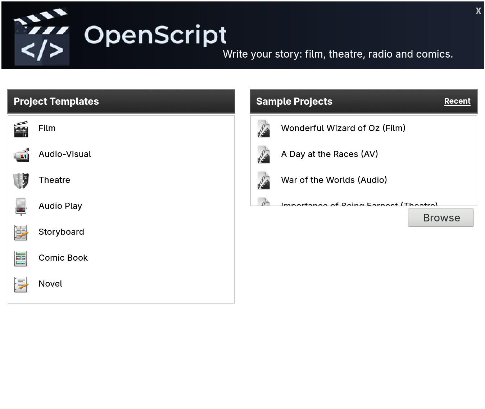
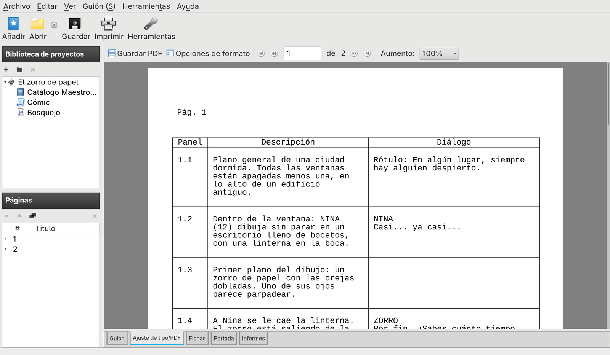

<p align="center">
  
</p>

# OpenScript

🌐 **English** · [Español](README.es.md) · ❤️ [Support the project](#support-openscript)

**A simple, professional, open-source program for writing screenplays, comics, stage plays,
radio plays and more.** A revival of the legendary Celtx 2.9.7, brought back to life for today's
computers.

> OpenScript is an independent project based on the open-source code of Celtx 2.9.7
> (Mozilla Public License 2.0). **It is not affiliated with, sponsored or endorsed by Celtx Inc.**
> "Celtx" is a registered trademark of its respective owner. See [NOTICE.md](NOTICE.md).

## Screenshots

| Screenplay | Print preview (PDF) |
|---|---|
|  |  |
| **Comic script** | **Comic PDF: Panel / Description / Dialogue** |
|  |  |
| **Welcome screen** | **Spanish interface** (follows your system language) |
|  |  |

## Why OpenScript exists

Celtx 2.9.7 was simple and useful. You opened it and wrote your screenplay, stage play or comic in
the right format, with no accounts, no subscriptions and no internet connection required. Many of us
learned to write scripts with it.

When Celtx abandoned the desktop version, that program was left trapped in obsolescence. It stopped
installing on modern systems, and key features such as PDF export broke because they depended on
servers that were shut down. The program itself was still good, and its code is open.

**OpenScript was born from the belief that a tool like this does not deserve to be locked away in
obsolescence.** The goal is to keep it alive, free and working on current computers, and to make
sure that whatever you write with it can always be opened, thanks to open formats such as Fountain.

## Simple on purpose

Many writing tools today pile on hundreds of features: cloud workspaces, collaboration dashboards,
production pipelines, AI assistants. All of that gets between you and the page. OpenScript goes
the other way: **it is made for writing.** You open it, choose the kind of script and start typing;
the formatting takes care of itself. Everything it has is there to help you write, and nothing
else competes for your attention.

## Features

Everything the Celtx 2.9.7 desktop program offered, working offline:

- **Script formats:** screenplay (film), stage play (theatre), audio play (radio/podcast),
  two-column audio-visual (AV), comic book and novel.
- **Automatic formatting:** scene headings, action, characters, dialogue, parentheticals,
  transitions, shots, panels and captions. *Tab* and *Enter* jump to the right element, and
  character names and scene headings autocomplete.
- **Adapt a script to another format,** for example a screenplay into a stage play.
- **Title page,** scene numbering, page breaks and industry-standard print layout.
- **Index cards** to outline and reorder scenes, plus a **scratchpad** for loose ideas.
- **Notes and media** (images, audio, links) attached to any point of the script.
- **Master catalog and script breakdown:** characters, locations, props, wardrobe, effects and
  more, with breakdown reports.
- **Reports** of scenes, characters and dialogue.
- **Storyboard** editor and a simple **sketch** tool for diagrams and floor plans.
- **Production calendar and schedule.**
- **Projects as single `.celtx` files** that keep all of your documents together.
- **Spell checking** in English and Spanish.

## What it adds to Celtx 2.9.7

Celtx desktop stopped being maintained in 2017, and several of its features relied on servers that
no longer exist. OpenScript brings it back to life:

- **PDF and print preview, offline.** Celtx used to send your script to its servers to typeset the
  PDF; OpenScript does it locally, with the same layout:
  - **Film:** industry-standard screenplay format.
  - **Comics:** one sheet per comic page, with a Panel | Description | Dialogue table.
- **Export to open and standard formats** from *Script → Export*:
  - **Fountain** (`.fountain`): plain text, the open screenplay standard.
  - **Final Draft** (`.fdx`).
  - **PDF**.
  - **OpenDocument** (`.odt`) and **Word** (`.docx`); these two need LibreOffice.
- **No errors at startup.** The calls to Celtx's dead online services, which caused encryption
  alerts (`ssl_error_no_cypher_overlap`), were removed.
- **English and Spanish interface**, following your system language, with spell checking in both.
  PDFs and exports use the same language.
- **Modern Linux:**
  - Readable light theme even when your desktop uses a dark theme.
  - Sharp preview on HiDPI/4K screens.
- **Your `.celtx` projects remain compatible:** they open and save exactly as before.

## Download and install

Get the latest version from the **[Releases](https://github.com/alexroses47/OpenScript/releases/latest)** page.

### Linux (x86_64): AppImage (recommended)

A single file that runs on almost any current distribution (Ubuntu 22.04 or later, Fedora,
Debian 12, openSUSE, Arch, Mint…) **with nothing else to install**: it bundles everything it needs.

```sh
chmod +x OpenScript-*-x86_64.AppImage
./OpenScript-*-x86_64.AppImage
```

- **Applications menu:** to add OpenScript and open `.celtx` files with a double click, run
  `./OpenScript-*-x86_64.AppImage --install`. Use `--uninstall` to remove it from the menu.
- **Alternative:** tools such as [Gear Lever](https://flathub.org/apps/it.mijorus.gearlever) or
  AppImageLauncher do the same graphically.

### Linux (x86_64): package with installer

```sh
tar xzf OpenScript-*-linux-x86_64.tar.gz
cd OpenScript
./install.sh
```

The installer checks dependencies and, if something is missing, prints the exact command to
install it (for example on openSUSE: `sudo zypper in libpng12-0`). To uninstall, run
`./uninstall.sh`. Your profile and projects are kept.

### Windows (10 and 11)

1. Unzip `OpenScript-*-windows.zip` anywhere (for example, in `Documents`).
2. Open **`OpenScript.exe`**.

No installation needed. To export to ODT/DOCX, install [LibreOffice](https://www.libreoffice.org/).

### macOS

Not supported. The Mac engine of Celtx 2.9.7 is 32-bit, and macOS stopped running 32-bit
programs with Catalina (10.15). Your `.celtx` files can be opened and exported on Linux or Windows.

## How it is built

OpenScript does not redistribute a hand-modified Celtx. It takes the **original** Celtx 2.9.7
builds (Linux and Windows) and applies the changes in this repository:

| Folder | Contents |
|---|---|
| `overlay/common/` | Changes for all platforms:<br>• no calls to dead services<br>• extended Export menu<br>• OpenScript branding (texts, welcome screen, About)<br>• help links to this project<br>• dead Celtx online services hidden<br>• interface language follows the system |
| `overlay/linux/` | Launcher, GTK theme fix and readability styles. |
| `server/` | Local server (Python) for PDF, preview and export (Fountain, FDX, ODT, DOCX), plus the Windows launcher. |
| `scripts/assemble.py` | Builds the packages from the original binaries. |
| `packaging/linux/` | Installer and uninstaller for the `.tar.gz` package. |
| `packaging/appimage/` | AppImage build (libpng 1.2, GTK2, frozen server). |
| `build.sh` | One-command local build. |
| `.github/workflows/` | Automated builds of the AppImage, the Linux package and the Windows package, tested on several distributions. |

The original Celtx 2.9.7 binaries are published as assets of the `upstream-2.9.7` release, so the
build does not depend on download links that no longer exist. The original Celtx 2.9.7 source code
(MPL 2.0) was published by Celtx as `celtx-2-9-7-src.tar.bz2`.

### Build it yourself

A single command downloads the original binaries (verifying their SHA-256 checksums) and builds
the package in `dist/`:

```sh
git clone https://github.com/alexroses47/OpenScript.git
cd OpenScript
./build.sh            # AppImage
./build.sh tarball    # .tar.gz package with installer
```

- **AppImage:** built inside an Ubuntu 22.04 container, so you only need `podman` or `docker`. If
  you are already on Ubuntu 22.04 with the dependencies installed, it builds directly.
- **`.tar.gz` package:** needs `python3`, `gcc` and `7z`.
- **Windows:** the package is built by GitHub Actions
  ([`.github/workflows/build.yml`](.github/workflows/build.yml)). If you fork the repository, you
  get your own Linux and Windows packages automatically.

## Support OpenScript

OpenScript is free and will always be free. If it's useful to you and you'd like to give
something back, you can make a donation in crypto. Contributions go toward the AI tools and the
build machines that help this open-source project move faster.

**USDC on the Solana network**


```
DE3ZBDqJ1iUunRTz7KkQQj8QrNFdHkyjv38FNQHLchJT
```

> [!WARNING]
> Only send **USDC** over the **Solana** network to this address. Any other coin, or the same
> coin sent over a different network, will be lost and cannot be recovered.

**Please note:** donations are voluntary and cannot be refunded. They don't pay for anything in
return: no product, service, perks, early or exclusive builds, priority support, or influence
over the project's direction. Every release remains free and public for everyone.

## Credits

- **Original program:** Celtx 2.9.7, by the Celtx team (Greyfirst Corp.), released as open
  source under the MPL 2.0. The original credits are kept in the app's *About* window.

## License

[Mozilla Public License 2.0](LICENSE), the same as Celtx 2.9.7. Third-party components are listed
in [NOTICE.md](NOTICE.md).
