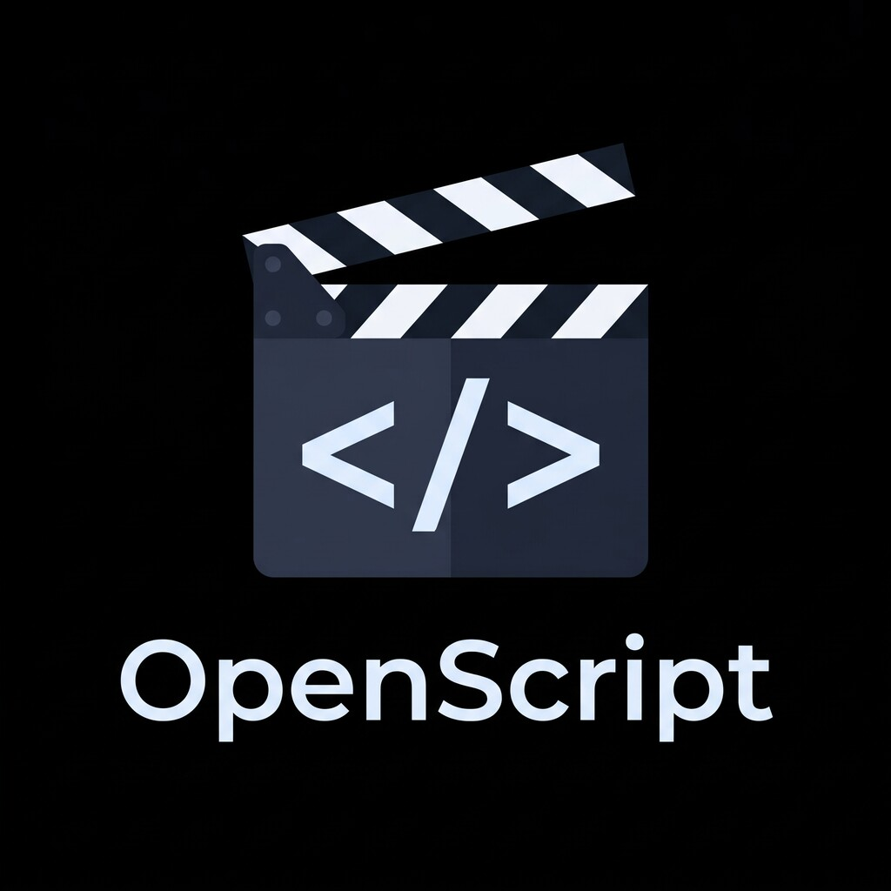

<p align="center">
  
</p>

# OpenScript

**Programa de código abierto para escribir guiones de cine, cómics, teatro, radio y más.**
Una reimplementación del legendario Celtx 2.9.7, actualizada para que funcione en equipos actuales.

> OpenScript es un proyecto independiente basado en el código abierto de Celtx 2.9.7
> (Mozilla Public License 2.0). **No está afiliado, patrocinado ni respaldado por Celtx Inc.**
> «Celtx» es una marca registrada de su respectivo propietario. Consulta [NOTICE.md](NOTICE.md).

## Qué aporta respecto a Celtx 2.9.7

Celtx de escritorio dejó de mantenerse en 2017 y varias de sus funciones dependían de
servidores que ya no existen. OpenScript lo devuelve a la vida:

- **PDF y vista previa sin internet.** El PDF lo generaba un servidor de Celtx que ya no existe;
  ahora lo hace un servidor local con la misma maquetación:
  - **Cine:** guion en formato estándar de industria.
  - **Cómic:** una hoja por página del cómic, con la tabla Panel | Descripción | Diálogo.
- **Exportación a formatos libres y estándar** desde *Guion → Exportar*:
  - **Fountain** (`.fountain`): texto plano, el estándar abierto de guiones.
  - **Final Draft** (`.fdx`).
  - **PDF**.
  - **OpenDocument** (`.odt`) y **Word** (`.docx`); estos dos necesitan LibreOffice.
- **Sin errores al iniciar.** Se eliminaron las conexiones a los servicios antiguos de Celtx, que
  provocaban alertas de cifrado (`ssl_error_no_cypher_overlap`).
- **Interfaz en español** (con corrector ortográfico) y también en inglés.
- **Linux moderno:**
  - Tema claro legible aunque el escritorio use un tema oscuro.
  - Vista previa nítida en pantallas HiDPI/4K.
- **Tus proyectos `.celtx` siguen siendo compatibles:** se abren y guardan igual que antes.

## Descargar e instalar

Descarga la última versión desde la página de **Releases**.

### Linux (x86_64)

```sh
tar xzf OpenScript-*-linux-x86_64.tar.gz
cd OpenScript
./install.sh
```

El instalador comprueba las dependencias; si falta algo, te da el comando exacto para
instalarlo (por ejemplo, en openSUSE: `sudo zypper in libpng12-0`). Después, abre
**OpenScript** desde el menú de aplicaciones.

Para desinstalar: `./uninstall.sh`. Tu perfil y tus proyectos se conservan.

### Windows (10 y 11)

1. Descomprime `OpenScript-*-windows.zip` donde quieras (por ejemplo, en `Documentos`).
2. Abre **`OpenScript.exe`**.

No necesita instalación. Para exportar a ODT/DOCX, instala [LibreOffice](https://www.libreoffice.org/).

### macOS

No es compatible. El motor de Celtx 2.9.7 para Mac es de 32 bits, y macOS dejó de ejecutar
programas de 32 bits a partir de Catalina (10.15). Tus archivos `.celtx` se pueden abrir y
exportar en Linux o Windows.

## Cómo está hecho

OpenScript no redistribuye un Celtx modificado a mano. Toma las versiones **originales**
de Celtx 2.9.7 (Linux y Windows) y les aplica los cambios de este repositorio:

| Carpeta | Contenido |
|---|---|
| `overlay/common/` | Cambios para todas las plataformas:<br>• servicios sin conexiones caducadas<br>• menú Exportar ampliado<br>• marca OpenScript |
| `overlay/linux/` | Lanzador, ajuste de tema GTK y estilos de legibilidad. |
| `server/` | Servidor local (Python) de PDF, vista previa y exportación (Fountain, FDX, ODT, DOCX), más el lanzador de Windows. |
| `scripts/assemble.py` | Arma los paquetes a partir de los binarios originales. |
| `packaging/linux/` | Instalador y desinstalador para Linux. |
| `.github/workflows/` | Compilación automática de los paquetes de Linux y Windows. |

Los binarios originales de Celtx 2.9.7 se publican como archivos de la release
`upstream-2.9.7`, para no depender de enlaces que ya no existen. El código fuente original
de Celtx 2.9.7 (MPL 2.0) está publicado por Celtx como `celtx-2-9-7-src.tar.bz2`.

### Compilar localmente (Linux)

```sh
python3 scripts/assemble.py linux \
  --linux-tar Celtx-2.9.7-64.tar.bz2 \
  --win-paf CeltxPortable_2.9.7_Spanish_Development_Test_1.paf.exe \
  --out dist --wheels
```

Requiere `gcc` y `7z`.

## Licencia

[Mozilla Public License 2.0](LICENSE), igual que Celtx 2.9.7. Los componentes de terceros
se detallan en [NOTICE.md](NOTICE.md).
